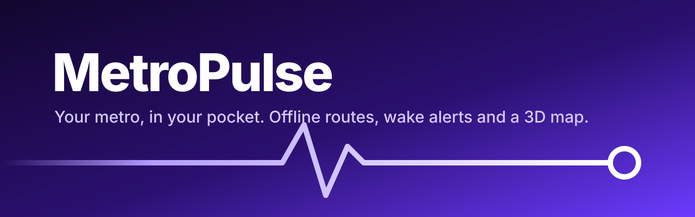
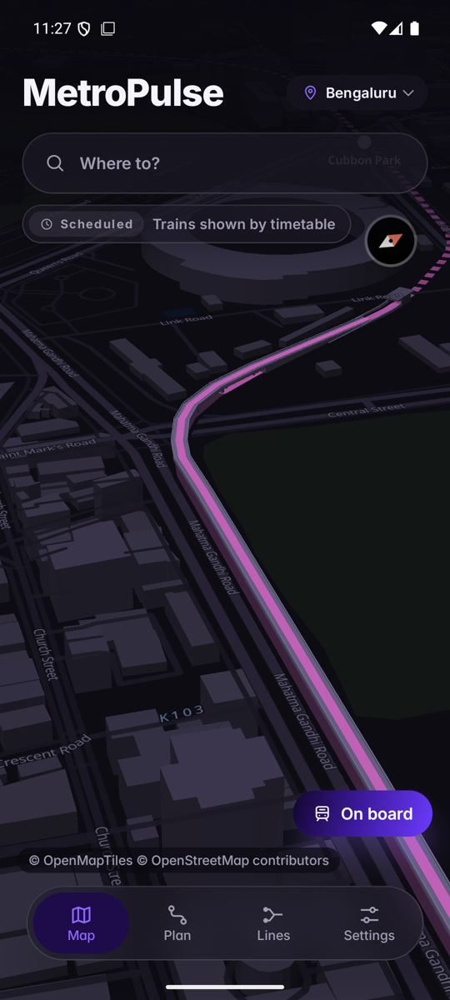
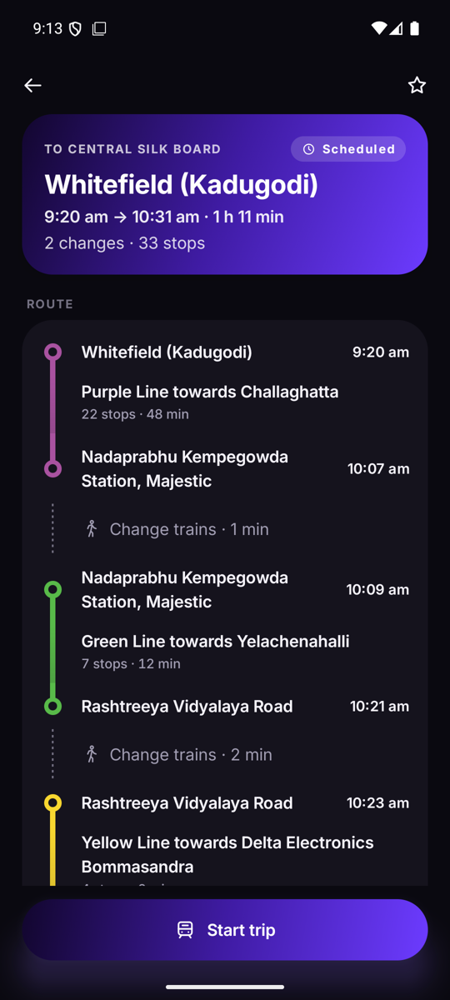
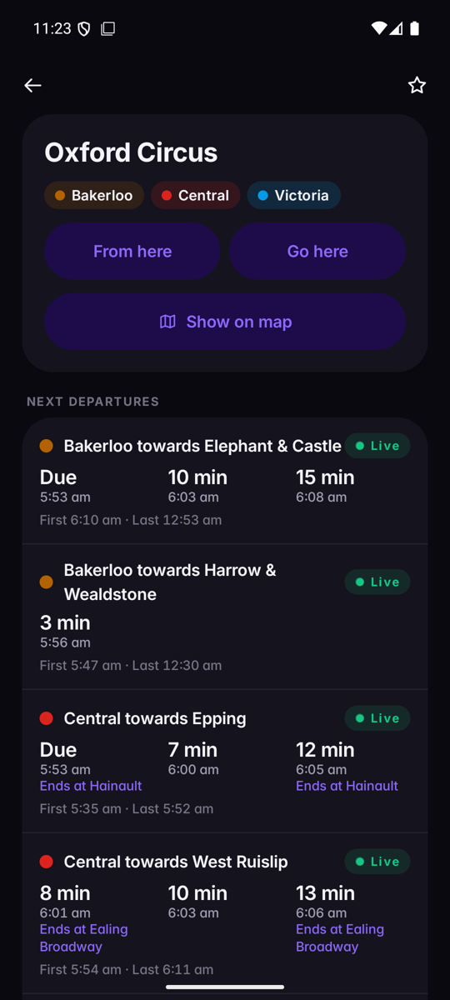
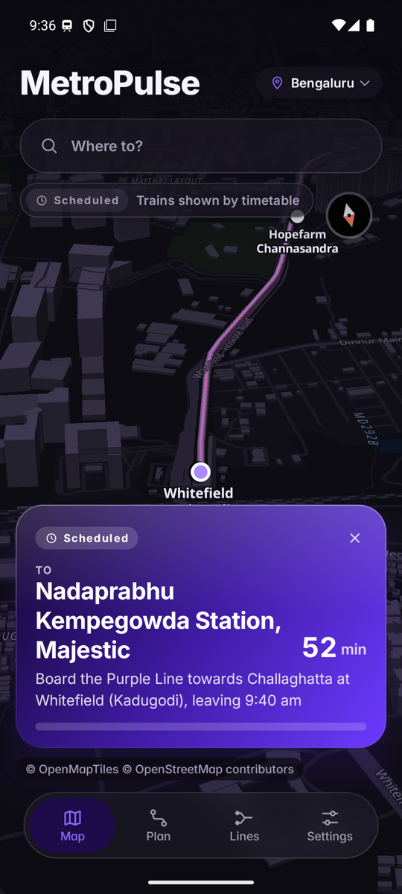
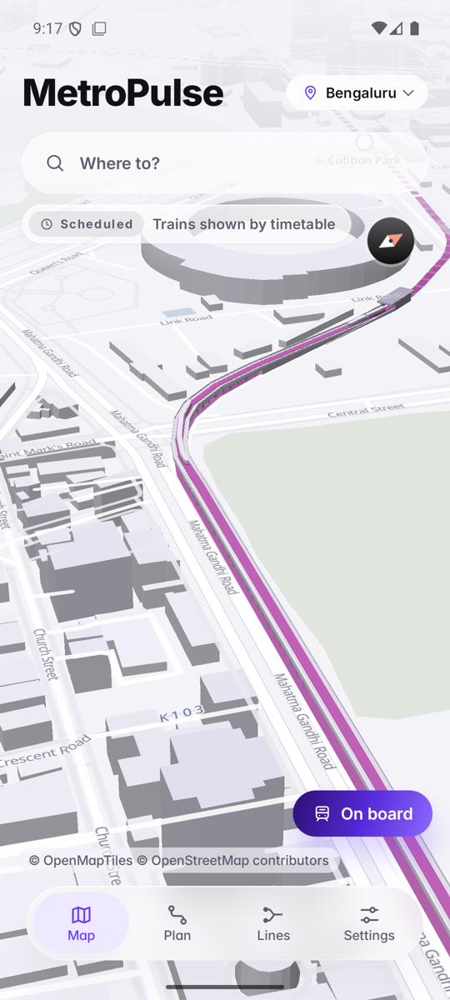
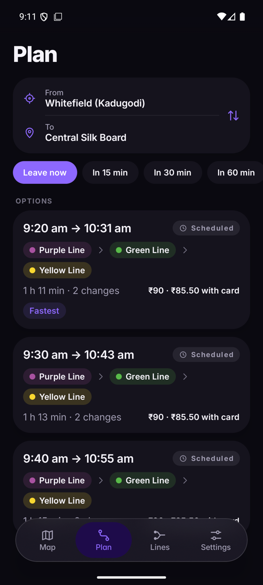
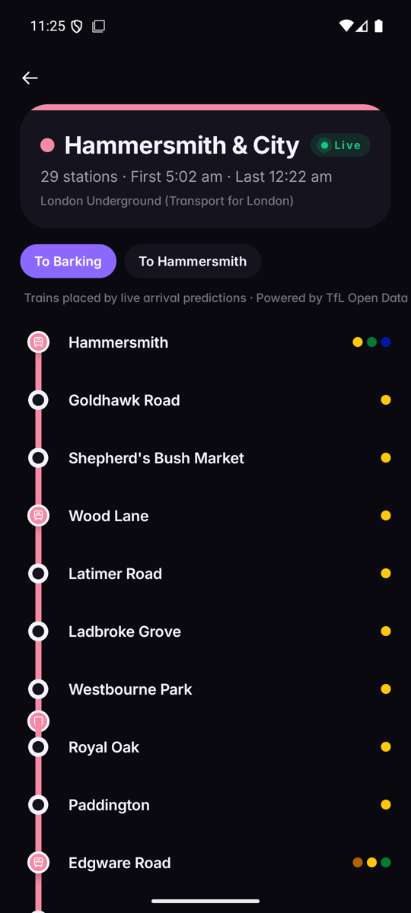
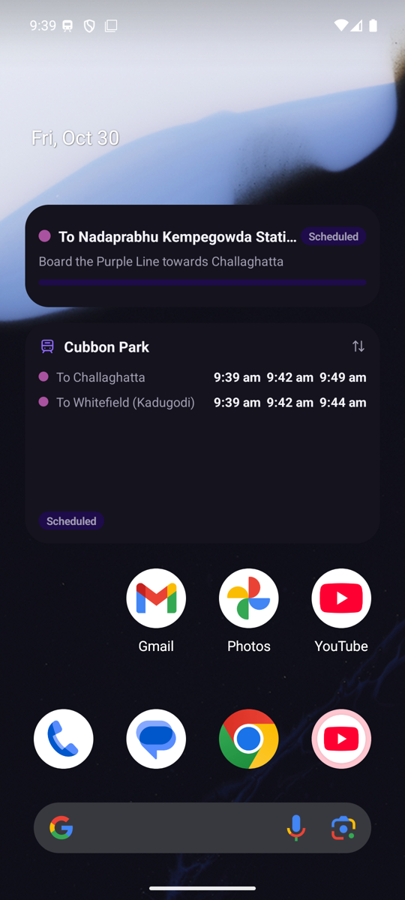
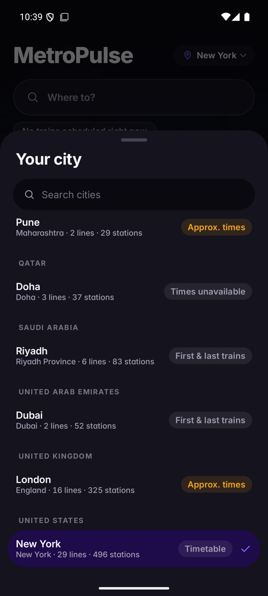

<p align="center"></p>

<p align="center">
  <a href="https://github.com/Arnav-Dugad/metropulse/releases/latest"></a>
  <a href="LICENSE"></a>
  
</p>

**MetroPulse** is a free, open-source metro app for 26 cities in India, the Gulf, London and New
York. It plans journeys offline, follows your train with a 3D map, and wakes you a stop or two
before yours. It never shows invented times: every time says whether it is **Live**,
**Scheduled** or **Approx.**, and where an operator publishes nothing, the app says so.

No account. No ads. No tracking. Your location never leaves your phone.

<p align="center">
  
  
  
  
</p>

## Features

- **3D network map** with viaducts, embankments, cuttings and tunnel portals, and trains moving
  along them by the timetable (or by live predictions in London).
- **Journey planner** that works offline: fastest and fewest-change options, a timeline of every
  change and walk, and fares in each city's currency, including card discounts where published.
- **On-board mode**: follows your train by GPS (and by the timetable underground), shows your
  trip on the lock screen as a Live Update on Android 16, and rings a **wake alert** one or two
  stops before your destination, even with the screen off.
- **Station details**: next trains per line and direction, first and last trains, exits and
  step-free access; **line strip maps** with trains moving along them.
- **Live arrivals in London and New York** from TfL's and the MTA's feeds, fetched by your phone directly.
- **Home-screen widgets** (next trains, your trip), launcher shortcuts and a **"Start my
  commute"** Quick Settings tile.
- **Offline maps**: download a city's map for use without a connection.
- Light and dark themes, high contrast, reduced motion, large-text and TalkBack support.
- **Updates itself** from GitHub Releases, verifying every download's SHA-256 and signature.

<p align="center">
  
  
  
  
  
</p>

## Cities

| City | Country | Lines | Stations | Times |
|---|---|---:|---:|---|
| Agra | India | 1 | 6 | First & last trains |
| Ahmedabad – Gandhinagar | India | 4 | 53 | Approx. (some days or lines first & last only) |
| Bengaluru | India | 3 | 83 | Timetable |
| Bhopal | India | 1 | 8 | First & last trains |
| Chennai | India | 4 | 52 | Approx. |
| Delhi | India | 11 | 253 | First & last trains |
| Gurugram | India | 1 | 11 | Approx. |
| Hyderabad | India | 3 | 58 | Approx. (some days or lines first & last only) |
| Indore | India | 1 | 16 | First & last trains |
| Jaipur | India | 1 | 11 | Approx. |
| Kanpur | India | 1 | 14 | Approx. (some days or lines first & last only) |
| Kochi | India | 1 | 25 | Approx. |
| Kolkata | India | 5 | 56 | Approx. |
| Lucknow | India | 1 | 21 | Approx. (some days or lines first & last only) |
| Meerut | India | 1 | 12 | First & last trains |
| Mumbai | India | 6 | 78 | Approx. (some days or lines first & last only) |
| Nagpur | India | 2 | 37 | Approx. (some days or lines first & last only) |
| Navi Mumbai | India | 1 | 11 | Approx. |
| Noida | India | 1 | 21 | Approx. (some days or lines first & last only) |
| Patna | India | 1 | 5 | Approx. |
| Pune | India | 2 | 29 | Approx. (some days or lines first & last only) |
| Doha | Qatar | 3 | 37 | Times unavailable |
| Riyadh | Saudi Arabia | 6 | 83 | First & last trains |
| Dubai | United Arab Emirates | 2 | 52 | First & last trains |
| London | United Kingdom | 16 | 312 | Approx., **live arrivals** |
| New York | United States | 29 | 496 | Timetable (MTA), **live arrivals** |

**Timetable**: the operator's schedule (Bengaluru via an unofficial GTFS feed). **Approx.**:
modelled from the operator's published first and last trains and frequencies. **First & last
trains**: the operator publishes no frequencies, so no departures are shown in between. Sources
for every city are in [DATA_SOURCES.md](DATA_SOURCES.md). City data updates arrive weekly without
an app update.

### Live data

London's live arrivals come from TfL's free [Unified API](https://api.tfl.gov.uk) and New York's
from the MTA's GTFS-realtime feeds, each called by the phone directly (no MetroPulse server). The
MTA's terms only allow this with its permission, which this project has; forks without it should
set `metropulse.mtaRealtime=false` in `gradle.properties`. No Indian or Gulf metro publishes a free
realtime feed; there, on-board mode follows your train with your phone's own GPS.

## Install

1. Download `MetroPulse-<version>.apk` from the [latest release](https://github.com/Arnav-Dugad/metropulse/releases/latest).
2. Open it and allow your browser or file manager to install apps when Android asks.
3. MetroPulse checks for updates itself (you can turn this off in Settings).

Every APK is signed with the same key. Its SHA-256 certificate fingerprint is:

```
CB:B3:18:B2:28:92:2A:C3:49:03:BD:1B:4B:12:AA:12:9B:30:7F:29:C5:50:13:A7:40:C7:F1:EC:EC:CA:F1:59
```

Check it with `apksigner verify --print-certs MetroPulse-<version>.apk`. Each release also lists
the APK's SHA-256.

## Build

Requires JDK 21 (Android Studio's bundled one works) and the Android SDK with platform 37.

```sh
./gradlew :app:assembleDebug      # debug APK
./gradlew test                    # unit tests
```

City databases are built by the Python pipeline in [`tools/`](tools/); see
[CONTRIBUTING.md](CONTRIBUTING.md). Releases are built and signed by
[GitHub Actions](.github/workflows/release.yml) when a `v*` tag is pushed.

## Privacy

No accounts, analytics, ads or crash reporting. Location is used only on your phone. The app
talks to OpenFreeMap (map tiles), GitHub (updates and city data) and, for live arrivals, TfL in
London and the MTA in New York. Details in [PRIVACY.md](PRIVACY.md).

## Credits and licences

- Code: [MIT](LICENSE).
- Map data © [OpenStreetMap](https://www.openstreetmap.org/copyright) contributors (ODbL), tiles
  © OpenMapTiles, served by [OpenFreeMap](https://openfreemap.org); style derived from
  [Positron](https://github.com/openmaptiles/positron-gl-style) (BSD 3-Clause / CC BY 4.0);
  rendered with [MapLibre Native](https://github.com/maplibre/maplibre-native).
- City databases are derived from OpenStreetMap and operator data and are licensed under the
  ODbL and the sources' terms; see [DATA_SOURCES.md](DATA_SOURCES.md).
- New York: data obtained from the Metropolitan Transportation Authority (MTA). MetroPulse is not
  licensed or endorsed by the MTA, and the MTA does not warrant that the data is accurate,
  complete or timely.
- London live arrivals: Powered by TfL Open Data. Contains OS data © Crown copyright and database
  rights 2016 and Geomni UK Map data © and database rights 2019. MetroPulse is not endorsed by TfL.
- [Inter](https://rsms.me/inter/) font (SIL Open Font License 1.1).

MetroPulse is an independent project and is not affiliated with any metro operator.
